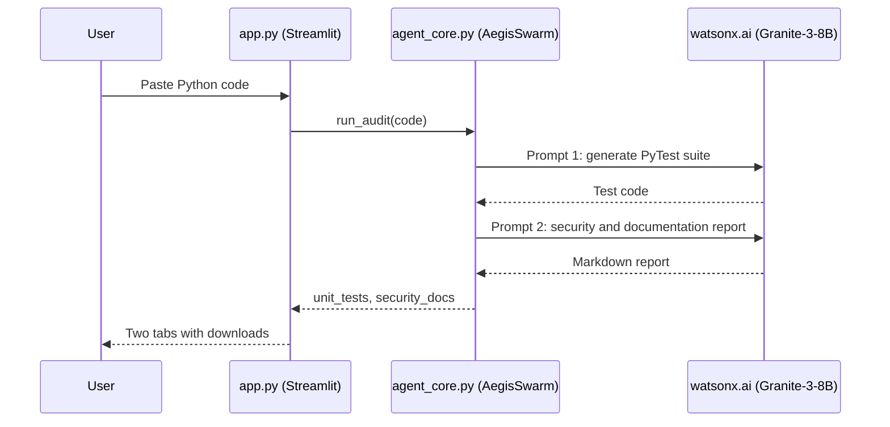

# Aegis-QA

> Paste a Python function and get a draft PyTest suite and a plain-language security review from IBM Granite (watsonx.ai), as a quick first pass before you write tests by hand.

**Status:** Hackathon prototype — IBM Bob Hackathon (lablab.ai), May 2026
**Demo:** [Live app](https://aegis-app1.streamlit.app/) (Streamlit Community Cloud; it sleeps when idle, so the first load redirects through a wake-up page and takes a few seconds)

## What it does

`app.py` is a Streamlit page with a text box. When you click the button, `AegisSwarm.run_audit()` in `agent_core.py` sends your code to the watsonx.ai text-generation API (model `ibm/granite-3-8b-instruct`) in **two sequential prompts**:

1. a QA prompt that asks for a PyTest suite, shown in a code tab with a download button (`test_aegis.py`);
2. a security prompt that asks for a Markdown vulnerability and documentation report, shown in a second tab with a download button (`aegis_report.md`).



## Quickstart

Requires Python 3 and an IBM watsonx.ai API key and project ID. The repo does not declare a minimum Python version.

```bash
git clone https://github.com/HamzaKhanBUIC/Aegis-QA.git
cd Aegis-QA
pip install -r requirements.txt
```

Create a `.env` file in the project root (see Configuration), then:

```bash
streamlit run app.py
```

Open `http://localhost:8501`. Without credentials the app shows `Swarm Failure: Missing Watsonx.ai credentials`.

## Configuration

| Variable | Required | Purpose |
| :-- | :-- | :-- |
| `WATSONX_API_KEY` | yes | IBM Cloud API key, exchanged for an IAM token at `iam.cloud.ibm.com` |
| `WATSONX_PROJECT_ID` | yes | watsonx.ai project used for text generation |

The endpoint (`us-south.ml.cloud.ibm.com`) and model ID are hard-coded in `agent_core.py`.

## Limitations

- **Not a swarm.** There are no separate agents, coordinator or parallelism. The class name `AegisSwarm` and some UI text ("Swarm", "Agentic Nodes Active" in the sidebar) are leftover branding; the sidebar list is decorative text. The two model calls run one after the other.
- **Not a static analyzer.** The code is not parsed (no AST or signature extraction); the raw text is placed into the prompt. The "security audit" is whatever Granite returns, so it can miss real issues and report false ones. Have a human review it.
- **Generated tests are unchecked.** They are not executed or validated by the app.
- **No tests or CI** in this repository.
- `requirements.txt` is unpinned.
- `bob_session/` holds transcripts and screenshots from building the app with IBM Bob; it is not used by the app.
- The live demo depends on a watsonx.ai key held by the deployment and can stop working if that key lapses.

## License

MIT, see [LICENSE](LICENSE).
