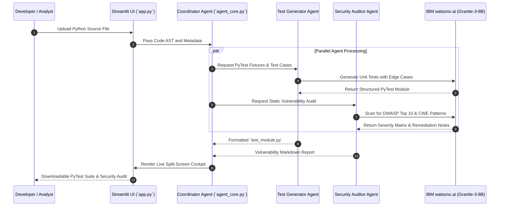

# Aegis-QA: Multi-Agent Security Audit & Test Generation Swarm

> Automated PyTest suite generation and static security vulnerability scanning powered by multi-agent orchestration and IBM watsonx.ai.

[](https://aegis-app1.streamlit.app/)
[](https://www.ibm.com/watsonx)
[](https://python.org/)
[](LICENSE)

---

## Overview

Software quality assurance and preliminary security auditing often require significant engineering overhead to construct comprehensive unit test coverage and identify OWASP Top 10 vulnerabilities.

**Aegis-QA** automates this workflow using a multi-agent orchestration pipeline:
1. **Source Code Ingestion**: Parses uploaded Python modules, AST structure, and function signatures.
2. **Test Generation Agent**: Constructs isolated PyTest suites including parameterization, mock fixtures, and boundary cases.
3. **Security Audit Agent**: Evaluates code against common vulnerability patterns (SQL injection, unsafe deserialization, insecure subprocess calls, credential exposure).
4. **Interactive Dashboard**: Delivers generated test files and structured vulnerability reports via a Streamlit interface.

---

## Architecture Flow



---

## Core Capabilities

- **Automated PyTest Generation**: Produces syntactically valid Python test files with parameterized cases and standard mock fixtures.
- **OWASP Vulnerability Scanning**: Identifies security risks including injection vectors, unvalidated inputs, and insecure library usages.
- **Multi-Agent Coordination**: Separates test synthesis and vulnerability analysis into dedicated agent roles to prevent context pollution.
- **Streamlit Interactive Cockpit**: Enables file upload, real-time agent execution tracking, and single-click artifact export.

---

## Repository Structure

```
.
├── app.py                    # Streamlit web interface and session state
├── agent_core.py             # Multi-agent coordination and watsonx.ai interface
├── requirements.txt          # Python dependencies
└── README.md
```

---

## Getting Started

### Prerequisites
- Python 3.10 or higher
- IBM watsonx.ai API credentials (or configured API key)

### Local Setup

1. **Clone the repository**:
   ```bash
   git clone https://github.com/HamzaKhanBUIC/Aegis-QA.git
   cd Aegis-QA
   ```

2. **Install dependencies**:
   ```bash
   pip install -r requirements.txt
   ```

3. **Configure environment variables**:
   Create a `.env` file in the project root:
   ```env
   WATSONX_API_KEY=your_watsonx_api_key
   WATSONX_PROJECT_ID=your_project_id
   ```

4. **Start Streamlit application**:
   ```bash
   streamlit run app.py
   ```
   Open `http://localhost:8501` in your browser.

---

## License

This project is licensed under the MIT License. See [LICENSE](LICENSE) for details.
